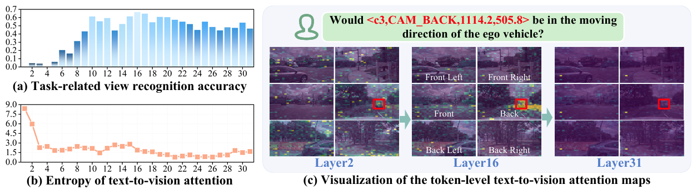
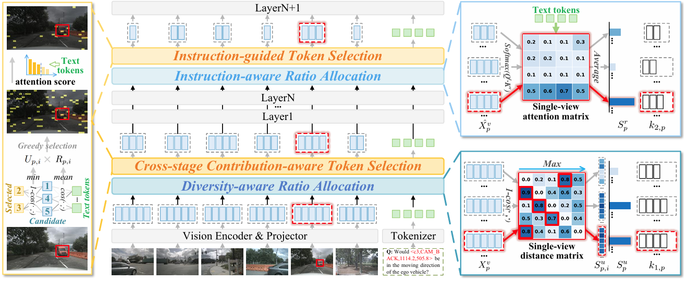

<div align="center">
  <h1 style="display: inline-block; margin: 0;">MVPruner: Dynamic Token Pruning for Accelerating Multi-view Vision-Language Models in Autonomous Driving</h1>
</div>

<h4 align="center">

[Nan Yang](),
[Zhanwen Liu](),
[Linfeng Zhang](),
[Shangyu Xie](),
[Yang Wang](),
[Wenzhuo Zhou](),
[Xiangmo Zhao]()

<br>

Accepted by **ECCV 2026 (ECCV26)**

</h4>

<div align="center">

[](https://arxiv.org/abs/2606.27660)


</div>

## News

- **[2026.06]** MVPruner is available on [arXiv](https://arxiv.org/abs/2606.27660).
- **[2026]** MVPruner has been accepted by **ECCV 2026 (ECCV26)**.

## Overview


- Our analysis reveals that multi-view VLMs allocate more pronounced attention to task-related views in deeper layers and exhibit dynamic information requirements, providing insights to guide method design.
- We propose MVPruner, which dynamically adjusts pruning ratios across different views in an online manner and adaptively retains important tokens according to the model’s dynamic information requirements.
- Experimental results demonstrate that our method achieves a superior efficiency–performance trade-off. With 10% of visual tokens retained, our method maintains accuracy of 98.0%, 98.5%, and 94.5%, outperforming the second-best method by 2.6%, 0.8% and 3.5%, achieving 3.80×, 4.97× and 3.95× speedup in the prefilling stage on DriveLMM-o1, DriveLM and MAPLM, respectively.
- The released code preserves the original DriveMM/LLaVA/Transformers loading path for straightforward reproduction.

<p align="center">
  
</p>
<p align="center">
  
</p>

## Getting Started

### 1. Clone This Repository

```bash
git clone https://github.com/Zizzzzzzz/MVPruner.git
cd MVPruner
```

### 2. Environment Setup

```bash
conda create -n mvpruner python=3.10 -y
conda activate mvpruner
pip install --upgrade pip
pip install -e ".[train]"
cd transformers
pip install -e .
cd ..
```

The experiments use the DriveMM/LLaVA dependency stack together with the vendored `transformers` package in this repository.

### 3. Download Checkpoint

Download the DriveMM checkpoint:

```bash
mkdir -p ckpt
cd ckpt
huggingface-cli download DriveMM/DriveMM --local-dir ./DriveMM --resume-download
cd ..
```

### 4. Prepare DriveLM Data

The included DriveLM evaluation file is:

```text
scripts/test_llama_eval.json
```

Image paths in this JSON are relative to the `scripts/` directory. Prepare the nuScenes data so that paths such as the following are valid:

```text
scripts/data/nuscenes/samples/CAM_FRONT/...
```

A typical layout is:

```text
MVPruner/
  ckpt/
    DriveMM/
  scripts/
    test_llama_eval.json
    data/
      nuscenes/
        samples/
```

## Inference

Run DriveLM inference from the `scripts/` directory.

### 90% Pruning

```bash
cd scripts
bash run_inference.sh 0 0.9 drivelm_mvpruner_90
```

### 75% Pruning

```bash
cd scripts
bash run_inference.sh 0 0.75 drivelm_mvpruner_75
```

The shell script uses the following arguments:

```text
bash run_inference.sh GPU_ID PRUNING_RATIO OUTPUT_NAME
```

Each run writes outputs to:

```text
scripts/output/OUTPUT_NAME/TIMESTAMP/
```

The output directory contains:

- `run_all.log`: runtime log and pruning configuration.
- `drivemm_original.json`: raw JSONL predictions.
- `drivemm_original_list.json`: list-formatted predictions.
- `submission.json`: DriveLM submission file.

You can also call the inference script directly:

```bash
cd scripts
python inference.py \
  --model-path ../ckpt/DriveMM \
  --data ./test_llama_eval.json \
  --pruning-ratio 0.9 \
  --output output/debug/drivemm_original.json
```

## Evaluation Guidance

For DriveLM evaluation, first fill in your team information at the top of `scripts/prepare_submission.py`:

```python
method = ""
team = ""
authors = [""]
email = ""
institution = ""
country = ""
```

Then run inference with `run_inference.sh`. The pipeline will generate `submission.json` in the output directory. Submit this file following the official DriveLM evaluation instructions.

## Implementation Notes

- The core MVPruner implementation is in `transformers/src/transformers/models/llama/modeling_llama_mvpruner.py`.

## License

This project is released under the [Apache 2.0 license](LICENSE).

## Citation

If this repository is helpful for your research, please cite MVPruner:

```bibtex
@article{yang2026mvpruner,
  title={MVPruner: Dynamic Token Pruning for Accelerating Multi-view Vision-Language Models in Autonomous Driving},
  author={Yang, Nan and Liu, Zhanwen and Zhang, Linfeng and Xie, Shangyu and Wang, Yang and Zhou, Wenzhuo and Zhao, Xiangmo},
  journal={arXiv preprint arXiv:2606.27660},
  year={2026}
}
```

## Acknowledgments

This codebase builds on the open-source implementations of Prune2Drive, DriveMM, DriveLM, LLaVA, and HuggingFace Transformers. We thank the authors and contributors for their valuable work.